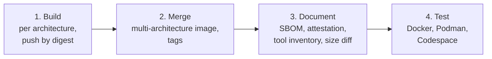
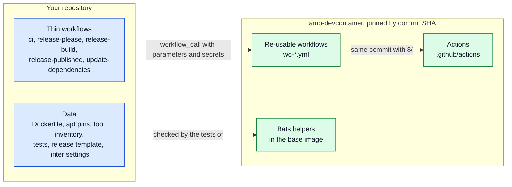
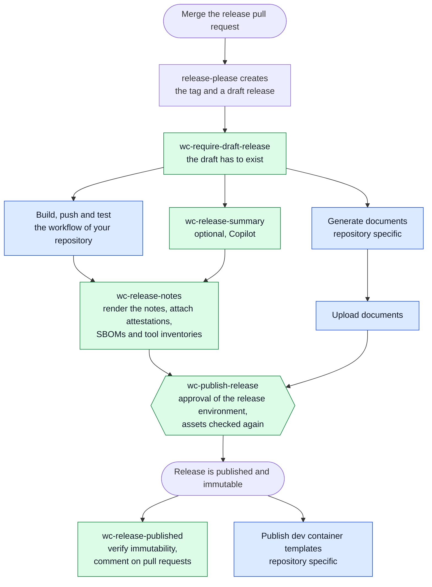
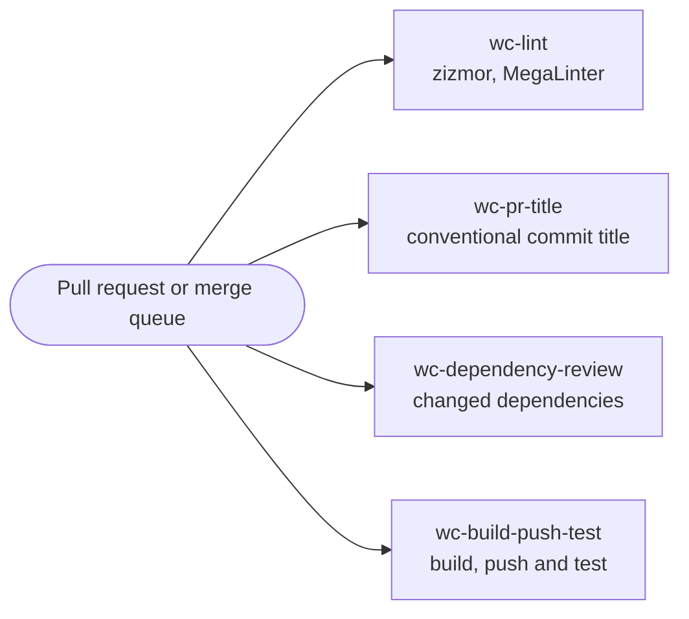

# The re-usable build system

amp-devcontainer is more than a set of containers: the way it builds, tests, and releases them is re-usable.
A repository that derives its own containers from amp-devcontainer can use the same workflows, actions and test helpers, and get the same supply-chain properties without maintaining them.

The build system does not know about the amp-devcontainer containers (the "flavors").
It builds one image, or many: a flavor is just a set of parameters (a Dockerfile, a name, some metadata) that a workflow in the calling repository passes in.
This document describes the building blocks, and the path we recommend to follow, the golden path.

## Building blocks

| Kind                | Location                                           | Purpose                                                                                                                |
|---------------------|----------------------------------------------------|------------------------------------------------------------------------------------------------------------------------|
| Re-usable workflows | [.github/workflows/wc-*.yml](../.github/workflows) | Build, push, test, and document images. `wc-build-push-test.yml` is the entry point.                                   |
| Actions             | [.github/actions](../.github/actions)              | Steps that the workflows are made of, and that can be used on their own. Released with the workflows, as `actions/vX`. |
| Test helpers        | [helpers](../helpers)                              | Bats libraries and tools that are installed in the base image, to test the containers.                                 |
| Base image          | [.devcontainer/base](../.devcontainer/base)        | The image to derive from; it contains Bats and the test helpers.                                                       |

The actions have a README with their inputs and outputs:

- [container-size-diff](../.github/actions/container-size-diff/README.md): report the size difference between two images
- [extract-manifest-digest](../.github/actions/extract-manifest-digest/README.md): get the digest of an image
- [generate-release-summary](../.github/actions/generate-release-summary/README.md): let Copilot draft the summary of a release
- [generate-tool-inventory](../.github/actions/generate-tool-inventory/README.md): derive the tools of an image from its SBOM
- [merge-devcontainer-metadata](../.github/actions/merge-devcontainer-metadata/README.md): carry over the `devcontainer.metadata` label of the base image
- [publish-release](../.github/actions/publish-release/README.md): check the assets of a draft release and publish it
- [registry-login](../.github/actions/registry-login/README.md): log in to a registry, with the identity of the workflow only for ghcr.io
- [render-release-notes](../.github/actions/render-release-notes/README.md): render the release notes of a release
- [replicate-image-tags](../.github/actions/replicate-image-tags/README.md): verify a released image and copy it to more tags, in other registries too
- [require-draft-release](../.github/actions/require-draft-release/README.md): require that the draft release of a tag exists
- [select-image-version](../.github/actions/select-image-version/README.md): select the image that an acceptance test uses
- [update-apt-packages](../.github/actions/update-apt-packages/README.md): update pinned apt packages
- [update-vscode-extensions](../.github/actions/update-vscode-extensions/README.md): update pinned VS Code extensions
- [upload-release-assets](../.github/actions/upload-release-assets/README.md): attach the attestations, tool inventories and optionally SBOMs of images to a release
- [verify-immutable-release](../.github/actions/verify-immutable-release/README.md): verify that a published release is immutable

The re-usable workflows that a repository calls, next to `wc-build-push-test.yml`:

- [wc-dependency-review.yml](../.github/workflows/wc-dependency-review.yml): review the dependencies that a pull request changes
- [wc-lint.yml](../.github/workflows/wc-lint.yml): lint and format with zizmor and MegaLinter (the `dotnet` flavor), and report to the pull request and code scanning. The settings are in `.mega-linter.yml`, see [Shared MegaLinter settings](#shared-megalinter-settings)
- [wc-pr-title.yml](../.github/workflows/wc-pr-title.yml): check that the title of a pull request is a conventional commit, with a comment that explains what to change
- [wc-publish-release.yml](../.github/workflows/wc-publish-release.yml): publish the draft release after the approval of an environment, see [Release](#5-release)
- [wc-release-please.yml](../.github/workflows/wc-release-please.yml): create the release pull request and the releases with [release-please](https://github.com/googleapis/release-please), with an installation token of a GitHub App (input `app-client-id` and secret `APP_PRIVATE_KEY`) so the release triggers other workflows
- [wc-release-notes.yml](../.github/workflows/wc-release-notes.yml) and [wc-release-summary.yml](../.github/workflows/wc-release-summary.yml): write the notes of a release, see [Release](#5-release)
- [wc-release-published.yml](../.github/workflows/wc-release-published.yml): after the publication, verify that the release is immutable and comment on the released pull requests
- [wc-replicate-images.yml](../.github/workflows/wc-replicate-images.yml): copy the images of a release to another registry, see [Replicate images](#replicate-images)
- [wc-require-draft-release.yml](../.github/workflows/wc-require-draft-release.yml): at the start of a release workflow, require that the draft release exists, see [Release](#5-release)
- [wc-update-apt-packages.yml](../.github/workflows/wc-update-apt-packages.yml) and [wc-update-vscode-extensions.yml](../.github/workflows/wc-update-vscode-extensions.yml): open a pull request that updates pinned apt packages and VS Code extensions, see [Keep the pins up to date](#4-keep-the-pins-up-to-date)

They all take the runner as `runner-labels`, a JSON array, and a workflow that logs in to a registry takes `registry` and the secrets `DOCKER_REGISTRY_USERNAME` and `DOCKER_REGISTRY_PASSWORD`.
The identity of the workflow is only valid for ghcr.io, so without these secrets ghcr.io is logged in to with it, and any other registry, such as Docker Hub, is used anonymously, which is enough to pull public images.
Pushing to a registry other than ghcr.io fails without credentials, see [registry-login](../.github/actions/registry-login/README.md).
A caller passes secrets explicitly, never with `secrets: inherit`.

The helpers are [bats-tool-inventory](../helpers/bats-tool-inventory/README.md), to check the installed tools and apt packages, and [add-sbom-note](../helpers/add-sbom-note/add-sbom-note.sh), to make tools that are not installed by a package manager show up in the SBOM.

## What `wc-build-push-test.yml` does

The workflow [wc-build-push-test.yml](../.github/workflows/wc-build-push-test.yml) takes the description of one image, and does everything from building to testing:



1. **Build**, on every architecture runner, and push by digest. The `devcontainer.metadata` label is merged with the one of the base image.
2. **Merge** the architectures into one multi-architecture image, and tag it: `pr-<number>` for a pull request, `edge` for the merge queue (when enabled), and the semantic versions for a release.
3. **Document the image**: create an SBOM, a build provenance attestation (which is verified right away), the tool inventory, a container diff, and a comment with the size difference with the `edge` image.
4. **Test the image**, by running Bats integration tests in it with Docker, and optionally Podman, and optionally an acceptance test in a Codespace.

The result is an image that is signed, can be traced back to its source, and has been tested with the container runtimes it supports.
Calling it with several images, in a matrix, gives you a family of containers: build the base image first, and pass it as `base-image` and as a build argument to the images that derive from it, like [build-push-test.yml](../.github/workflows/build-push-test.yml) does.

## The golden path

A repository that uses the build system contains the data that describes its images and a few thin workflows.
The workflows only call the re-usable workflows of amp-devcontainer with parameters and explicit secrets, and those call the actions at the same commit:



Everything that is specific to your repository, such as the registry, the runners and the names of your secrets, is a parameter of a call.
The shared parts, in green, are never copied.

The rest of this section is the path for a repository that builds its own containers on top of amp-devcontainer.
The files of amp-devcontainer itself follow it, so they can be used as an example.

### 1. Describe the image

Per image, add a directory `.devcontainer/<name>` with:

- a `Dockerfile` that starts `FROM` an amp-devcontainer image, pinned by digest. Let it take the image from an `ARG BASE_IMAGE`, so the same image can be given to the workflow in step 3;
- `apt-requirements*.json` files that pin the apt packages that the Dockerfile installs, as `{"package": "version"}`;
- a `devcontainer-metadata.json` with the settings and VS Code extensions for the dev container;
- a `tool-inventory.json` with the tools that the image promises to provide, see the [inventory format](../.github/actions/generate-tool-inventory/README.md#inventory-format).

Tools that are not installed with a package manager are invisible for SBOM tooling. Annotate them with `add-sbom-note` in the Dockerfile.

### 2. Test the image

Add a Bats file `test/<name>/integration-tests.bats` that uses the helpers from the base image:

```bash
setup() {
  bats_load_library bats-support
  bats_load_library bats-assert
  bats_load_library bats-tool-inventory

  DEVCONTAINER_DIR="${BATS_TEST_DIRNAME}/../../.devcontainer"
  INVENTORY="${DEVCONTAINER_DIR}/<name>/tool-inventory.json"
  APT_REQUIREMENTS=("${DEVCONTAINER_DIR}"/<name>/apt-requirements*.json)
}

@test "apt packages are installed at their pinned versions" {
  assert_apt_packages_at_pinned_versions "${APT_REQUIREMENTS[@]}"
}

@test "tools listed in the inventory are present in the image" {
  assert_inventory_tools_available "${INVENTORY}"
}

@test "commands listed in the inventory start successfully" {
  assert_inventory_tools_run "${INVENTORY}"
}
```

The tests run inside the image, so the same tests verify the pins, the inventory, and your own checks.
The helpers do not know about flavors: they get the files to check as arguments, so an image that is derived from another can pass the files of both.

### 3. Build, push and test in a workflow

Call the re-usable workflow. Pin it by commit SHA of a release, so your build only changes when you decide:

```yaml
jobs:
  build-push-test:
    uses: philips-software/amp-devcontainer/.github/workflows/wc-build-push-test.yml@<sha> # <version>
    permissions:
      actions: read
      artifact-metadata: write
      attestations: write
      contents: write
      id-token: write
      packages: write
      pull-requests: write
    with:
      base-image: ghcr.io/philips-software/amp-devcontainer-<flavor>@sha256:<digest>
      build-args: BASE_IMAGE=ghcr.io/philips-software/amp-devcontainer-<flavor>@sha256:<digest>
      dockerfile: .devcontainer/<name>/Dockerfile
      image-name: ${{ github.repository }}-<name>
      devcontainer-metadata-file: .devcontainer/<name>/devcontainer-metadata.json
      integration-test-file: test/<name>/integration-tests.bats
      tool-inventory-file: .devcontainer/<name>/tool-inventory.json
```

The permissions are what the jobs in the workflow need, the workflow has a comment per permission.
The inputs of the workflow are documented in the workflow file.
The `base-image` is the image of the `FROM` line.
Without it the `devcontainer.metadata` label of your image only has your own metadata, and the VS Code extensions and settings of the base image are lost.
Run the workflow for pull requests, and for the merge queue with `enable-edge-tag` so there is always an `edge` image to compare with.

### 4. Keep the pins up to date

Pinned apt packages and VS Code extensions are updated by the re-usable workflows [wc-update-apt-packages.yml](../.github/workflows/wc-update-apt-packages.yml) and [wc-update-vscode-extensions.yml](../.github/workflows/wc-update-vscode-extensions.yml),
which use the actions [update-apt-packages](../.github/actions/update-apt-packages/README.md) and [update-vscode-extensions](../.github/actions/update-vscode-extensions/README.md).
Call them from a workflow with a schedule, see [update-dependencies.yml](../.github/workflows/update-dependencies.yml).
They open a pull request, with the installation token of a GitHub App (`app-client-id` and `APP_PRIVATE_KEY`) so it triggers the other checks.
The apt packages are updated in the image itself, since it has all package sources set up (`container-image`, and `DOCKER_REGISTRY_USERNAME` and `DOCKER_REGISTRY_PASSWORD` when it is in a private registry).
The workflow does not ask for `packages: read`, so a private image in ghcr.io also needs these credentials. A public image is pulled without them.
Call the workflow once for each image, for example with a matrix.
Dependabot keeps the pinned actions, Dockerfile base images and other dependencies up to date.
The integration tests of step 2 fail when a pin and the installed package disagree.

### 5. Release

Releases are created with [release-please](https://github.com/googleapis/release-please) from [conventional commits](https://www.conventionalcommits.org), see [release-please.yml](../.github/workflows/release-please.yml).
The release is created as a **draft**, together with its tag, so nothing is visible to users and all assets can be attached before it is published. This is what makes [immutable releases](https://docs.github.com/en/repositories/releasing-projects-on-github/immutable-releases) possible.
The whole path, from merging the release pull request to the published release, looks like this:



Blue steps are specific to this repository and are written in your workflow; green steps are re-usable workflows.

The tag runs [release-build.yml](../.github/workflows/release-build.yml).
release-please creates the tag before the draft release, so the workflow first requires that the draft exists with [wc-require-draft-release.yml](../.github/workflows/wc-require-draft-release.yml), waiting for about a minute for it, and fails right away when it doesn't.
Then it builds, pushes and tests the images again, now with the semantic version tags, and:

- drafts a summary of the release with Copilot, with the re-usable workflow [wc-release-summary.yml](../.github/workflows/wc-release-summary.yml), in a job with a read-only token that is billed to the organization with [generate-release-summary](../.github/actions/generate-release-summary/README.md). A summary that can't be generated never fails the release;
- writes the release notes with the re-usable workflow [wc-release-notes.yml](../.github/workflows/wc-release-notes.yml), which is given the images, the tag and the image to render with (see its [usage](#release-notes-workflow)):
  - renders the release notes with [render-release-notes](../.github/actions/render-release-notes/README.md), with the summary, and the digests and tool inventories of the images, and can be run again without duplicating text;
  - uploads and checks the attestations, SBOMs and tool inventories as release assets with [upload-release-assets](../.github/actions/upload-release-assets/README.md);
- generates the documents (see [wc-document-generation.yml](../.github/workflows/wc-document-generation.yml)) and uploads them to the release;
- waits for the approval of the `release` environment, with [wc-publish-release.yml](../.github/workflows/wc-publish-release.yml): review the release notes of the draft, and approve to publish the release. The image assets are checked again immediately before publication, with [publish-release](../.github/actions/publish-release/README.md).

Publishing a release (approving the environment, or with **Publish release** on the releases page) runs [release-published.yml](../.github/workflows/release-published.yml), which publishes the dev container templates and calls [wc-release-published.yml](../.github/workflows/wc-release-published.yml) to comment on the released pull requests.
Publish only after release-build.yml has finished; the assets of an immutable release can't be changed or added later, only the title and release notes can.
Publishing manually bypasses the pre-publication check, so verify that all image assets are present before doing so.
The same workflow verifies that the published release is immutable with [verify-immutable-release](../.github/actions/verify-immutable-release/README.md), so a disabled repository setting is noticed.
Rejecting the approval leaves the draft in place, to be deleted or fixed with a new release.

If the check fails because there is no draft, release-please created the tag but not the release. Create the draft for the existing tag, and run the failed jobs of the workflow again:

```sh
gh release create <tag> --draft --verify-tag --title <tag> --notes "" --repo <owner>/<repository>
```

The release notes are rendered by the workflow. The check also fails for a release that is already published, which can't get more assets: create a new release instead.

#### Release notes workflow

Call it from the workflow that builds your release, after the images are built, and list the images of the release once.
The images are fully qualified, so the registry is only needed to log in to it:

```yaml
release-notes:
  needs: [build-push-test]
  uses: philips-software/amp-devcontainer/.github/workflows/wc-release-notes.yml@<sha> # <version>
  with:
    images: |
      my-registry.example/my-org/my-image-alpha
      my-registry.example/my-org/my-image-beta
    registry: my-registry.example # defaults to ghcr.io
    release-tag: ${{ github.ref_name }}
    render-image: ghcr.io/philips-software/amp-devcontainer-docs:<version> # or with a digest
    runner-labels: '["self-hosted", "linux", "x86_64"]' # defaults to ["ubuntu-latest"]
    template-file: .github/RELEASE_TEMPLATE.md.j2 # optional
  secrets:
    DOCKER_REGISTRY_USERNAME: ${{ secrets.MY_REGISTRY_USERNAME }} # not needed for ghcr.io, or for a public registry
    DOCKER_REGISTRY_PASSWORD: ${{ secrets.MY_REGISTRY_PASSWORD }}
  permissions:
    actions: read # to download the tool inventories
    attestations: read # to verify the attestations of the images, in private and internal repositories
    contents: write # to modify the release
    packages: read # to inspect private images in ghcr.io
```

The called workflow can't have more permissions than the caller grants, so the caller lists them.
The tool inventories are the artifacts `tool-inventory-<image basename>` of the same workflow run, which [wc-build-push-test.yml](../.github/workflows/wc-build-push-test.yml) creates.
The image to render with is pulled without credentials, and a reference without a digest is resolved to its digest first.
Pass `template-file` with a template of your own, see [render-release-notes](../.github/actions/render-release-notes/README.md#migrating-a-template).

To add a summary drafted by Copilot, call [wc-release-summary.yml](../.github/workflows/wc-release-summary.yml) in a job of its own with `contents: read` and `copilot-requests: write`, and pass `summary-artifact: release-summary` and `needs` of that job to the release notes.
A caller that doesn't use Copilot leaves it out, and doesn't need to grant that permission.
Make the release notes job run when the summary job failed as well, as [release-build.yml](../.github/workflows/release-build.yml) does with `!cancelled()`.

#### Draft, publish and verify workflows

A release workflow of a repository that uses draft releases is a handful of calls, with the build in the middle that only the repository knows:

```yaml
require-draft-release:
  uses: philips-software/amp-devcontainer/.github/workflows/wc-require-draft-release.yml@<sha> # <version>
  with:
    release-tag: ${{ github.ref_name }}
  permissions:
    contents: write # to find a draft release
build-push-test:
  needs: require-draft-release
  # ... calls your build, and then wc-release-summary.yml and wc-release-notes.yml
publish-release:
  needs: release-notes
  uses: philips-software/amp-devcontainer/.github/workflows/wc-publish-release.yml@<sha> # <version>
  with:
    app-client-id: ${{ vars.MY_APP_CLIENT_ID }}
    asset-names: ${{ needs.release-notes.outputs.asset-names }}
    release-tag: ${{ github.ref_name }}
  secrets:
    APP_PRIVATE_KEY: ${{ secrets.MY_APP_PRIVATE_KEY }}
```

The publication waits for the approval of the environment `release`, configure its required reviewers in the settings of the repository, or pass another name as `environment`.
A workflow for the `release` event calls `wc-release-published.yml` with the tag, once the release is published. It needs `attestations: read`, `contents: read` and `pull-requests: write`.

#### Replicate images

The images of a release are built, tested and attested in one registry, ghcr.io for amp-devcontainer.
To make them available in more registries, such as Docker Hub or Artifactory, copy them after the release instead of building them for every registry.
The copy has the same digest, so the attestation, SBOM and tool inventory of the release are valid for it, and an image that was not released never gets there.
[wc-replicate-images.yml](../.github/workflows/wc-replicate-images.yml) verifies the attestation of every image, and gives the copies the tags of the release (the version with and without `v`, the major and minor versions, and `latest`).
It never moves a tag: a tag that has another digest fails the workflow.
Call it once for each registry, after the release is published:

```yaml
replicate-images-my-registry:
  needs: publish-release
  uses: philips-software/amp-devcontainer/.github/workflows/wc-replicate-images.yml@<sha> # <version>
  with:
    images: |
      ghcr.io/my-org/my-image-alpha
      ghcr.io/my-org/my-image-beta
    release-tag: ${{ github.ref_name }}
    target-namespace: my-org
    target-registry: registry.example.invalid
  permissions:
    attestations: read # to verify the attestations of the images, in private and internal repositories
    contents: read # to read the repository
    packages: read # to read private images in ghcr.io
  secrets:
    TARGET_REGISTRY_PASSWORD: ${{ secrets.MY_REGISTRY_PASSWORD }}
    TARGET_REGISTRY_USERNAME: ${{ secrets.MY_REGISTRY_USERNAME }}
```

The copy is named `<target-registry>/<target-namespace>/<name of the image>`, so `ghcr.io/my-org/my-image-alpha` is copied to `registry.example.invalid/my-org/my-image-alpha`.
The credentials of the target registry are secrets of the repository, because a secret of an environment can't be passed to a re-usable workflow without `secrets: inherit`. Give them the rights to push to these repositories only.
A repository that wants to use environment secrets calls the [replicate-image-tags](../.github/actions/replicate-image-tags/README.md) action from a job with `environment:` instead.
The workflow [replicate-images.yml](../.github/workflows/replicate-images.yml) copies one image of an existing release by hand, to rehearse a registry with a scratch namespace before a release uses it, or to catch up.
Registries are logged in to with [registry-login](../.github/actions/registry-login/README.md), and a repository must exist in the target registry before the first push when the registry does not create it (Quay and Artifactory don't).

### 6. Check pull requests

Call [wc-lint.yml](../.github/workflows/wc-lint.yml), [wc-pr-title.yml](../.github/workflows/wc-pr-title.yml) and [wc-dependency-review.yml](../.github/workflows/wc-dependency-review.yml) from a workflow that runs for pull requests and the merge queue, next to the build:



#### Shared MegaLinter settings

[mega-linter-base.yml](../.github/linters/mega-linter-base.yml) holds the MegaLinter settings that every repository shares: which linters are enabled, and which are disabled because they are run elsewhere or are too noisy.
Extend it from the `.mega-linter.yml` of your repository, and keep only what is specific to your repository there.
Pin the URL to the same commit as the workflows, and let `CONFIG_PROPERTIES_TO_APPEND` add to the lists of the base instead of replacing them:

```yaml
EXTENDS: https://raw.githubusercontent.com/philips-software/amp-devcontainer/<sha>/.github/linters/mega-linter-base.yml
CONFIG_PROPERTIES_TO_APPEND:
  - DISABLE_LINTERS
DISABLE_LINTERS:
  - REPOSITORY_KICS
```

This repository extends the file by its path.

### 7. Verify

Everyone that uses an image can verify where it comes from, and that the release is immutable and its assets are the published ones:

```sh
gh attestation verify --repo <owner>/<repository> \
  --signer-workflow philips-software/amp-devcontainer/.github/workflows/wc-build-push.yml \
  oci://<registry>/<image>@<digest>
gh release verify --repo <owner>/<repository> <tag>
gh release verify-asset --repo <owner>/<repository> <tag> <asset>
```

The attestation is signed by the re-usable workflow [wc-build-push.yml](../.github/workflows/wc-build-push.yml) of amp-devcontainer, not by a workflow in your repository.
Without `--signer-workflow`, the verification expects the signing workflow in `<owner>/<repository>` and fails.
The workflows of this repository and the [upload-release-assets](../.github/actions/upload-release-assets/README.md) action do this for you.

The release attestation is created by GitHub when an immutable release is published, nothing in the workflows creates it. Enable immutable releases in the repository settings.
Releases that were published before the setting was enabled are not immutable and have no release attestation, so `gh release verify` and `gh release verify-asset` fail for them.

## Versioning and pinning

A repository that uses the build system pins the re-usable workflows by commit SHA, with the version as a comment, so they never change without a pull request: `philips-software/amp-devcontainer/.github/workflows/wc-<name>.yml@<sha> # <version>`.
Use the same version for all of them.
The workflows and actions are released together as `actions/vX.Y.Z`, separate from the containers (`vX.Y.Z`) so that the release notes of the containers only describe the containers. A commit SHA of any release contains all workflows and actions of that commit, so an older pin of a container release keeps working.

The workflows of this repository call the actions and each other with `$/.github/...`, the self-repository syntax. It resolves to the repository and commit of the workflow that contains it, also when your repository calls that workflow.
Pinning a workflow therefore pins every workflow and action below it to the same commit, and you don't pin the actions that the workflows use.
Pin an action yourself only when you call it directly, with `philips-software/amp-devcontainer/.github/actions/<name>@<sha> # actions/vX.Y.Z`.
The syntax is not available in GitHub Enterprise Server.

Versions that are pinned in more than one place are checked by the [version consistency tests](../test/repository/version-consistency.bats), so all uses of an action, container image or tool are updated together.

## Testing the build system itself

The actions, helpers and the consistency of the pins have tests that do not need a container build:

```bash
bats helpers/*/test .github/actions/*/test test/repository                    # in the amp-devcontainer-docs container, or with Bats installed
npm ci --ignore-scripts --prefix .github/actions/container-size-diff && npm test --prefix .github/actions/container-size-diff
```

They run in the pull request checks, in the jobs `Helper, Action & Repository Tests` and `Node.js Action Tests` of [continuous-integration.yml](../.github/workflows/continuous-integration.yml), independent of building the containers.
The tests use generated fake input, and stub the commands that talk to a registry or to GitHub.
